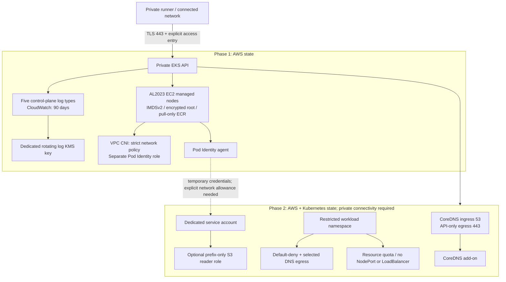

# terraform-aws-eks-security-baseline

[](https://github.com/jayekwere/terraform-aws-eks-security-baseline/actions/workflows/verify.yml)
[](LICENSE)

An opinionated Terraform baseline for **a new private EKS cluster and restricted workload namespaces**. It composes the established `terraform-aws-modules/eks/aws` module, narrows its configuration surface, and tests the resources it actually plans.

**Development release. No AWS infrastructure has been deployed or runtime-tested for this project.** Local verification covers real Terraform schemas, mocked AWS/Kubernetes plans, deliberate source regressions, and actual Kubernetes admission requests on a disposable kind cluster. This is a reviewable starting point, not a production certification or a complete platform. See [verification and remaining blockers](docs/verification.md).

**Hosted verification, October 28, 2026:** [all four jobs passed](https://github.com/jayekwere/terraform-aws-eks-security-baseline/actions/runs/40735904173): 23 native runs, 26 composed-resource contracts and 13 rejected source mutations on **each** Terraform version; 12 real Kubernetes admission requests; Checkov **40 passed / 0 failed / 0 skipped** on authored Terraform. [Downloaded, source-checked evidence](docs/evidence/hosted-verification.json).

## What this adds

- Private-only Kubernetes API; explicit source security groups; prerequisites reject public-IP subnets, direct internet-gateway routes, wrong-VPC subnets, single-AZ placement and disabled VPC DNS.
- API access entries only; no implicit creator administrator. One explicitly named bootstrap/recovery role is cluster admin. Optional viewers get `AmazonEKSViewPolicy` for exact namespaces, without wildcard scopes.
- All five control-plane log types, 90-day CloudWatch retention and a rotating, dedicated customer-managed log key. Named key administrators and optional log readers; service use bound to this log group's encryption context.
- Linux EC2 managed nodes with IMDSv2, hop limit one, encrypted gp3 root volumes and no SSH key. Node IAM has worker-node and ECR **pull-only** policies. IPv4 CNI permissions live in a separate Pod Identity role.
- VPC CNI network policy enabled in **strict** startup mode. CoreDNS is installed separately, after its policies exist, to avoid a bootstrap deadlock.
- Workload namespaces enforce version-pinned **restricted** Pod Security Admission, deny ingress/egress by default, allow only in-cluster DNS, disable API-token automount on a dedicated service account, and limit resource consumption and public Service types.
- An optional Pod Identity child module demonstrates an exact cluster/namespace/account trust boundary and `s3:GetObject` for one explicit object prefix. No arbitrary IAM-policy passthrough.

## Architecture and apply boundary



Phase 1 deliberately has **no CoreDNS**. Do not schedule applications until phase 2 is complete. The second Terraform root uses a pre-existing cluster and short-lived `aws eks get-token` execution, avoiding a Kubernetes provider pointed at a cluster that does not yet exist.

## Compatibility

| Component | Constraint / selected version |
| --- | --- |
| Terraform | `>= 1.15.0, < 2.0.0`; CI exercises **1.15.8 and 1.17.0** |
| AWS provider | `>= 6.59.0, < 7.0.0`; checked-in lockfiles select **6.70.0** |
| Kubernetes provider | `>= 2.38.0, < 3.0.0`; lockfiles select **2.38.0** |
| Upstream EKS module | **21.29.0**, pinned to commit [`91f11ea`](https://github.com/terraform-aws-modules/terraform-aws-eks/tree/91f11ea01656c26b8e6b8eb1b74f19863f60056c) |
| EKS / PSA | Explicit minors **1.34–1.37**; examples select **1.35**. This is a reviewed input range, not live validation of every minor. |
| VPC CNI | Exact **1.21.x or newer 1.x** build, verified for the target region/minor; Linux kernel **5.10+** |
| Platform | Commercial AWS, IPv4, AL2023 x86_64 EC2 nodes; no Auto Mode, Fargate, Windows, hybrid nodes or alternate CNI |

Add-on build strings are **required inputs**, with no `latest` fallback. Test builds are synthetic compatibility-shaped fixtures, not deployment recommendations. Resolve actual builds using the [preflight guide](docs/operations.md). Provider lockfiles pin selections/checksums; they do not lock transitive Terraform modules. The disabled upstream KMS submodule references Registry version 4.0.0. OpenTofu and the minimum provider versions have not been tested.

## Use the module

A published GitHub tag is usable without Terraform Registry enrollment:

```hcl
module "eks_baseline" {
  source = "git::https://github.com/jayekwere/terraform-aws-eks-security-baseline.git?ref=v0.1.0"

  name                          = "eks-baseline-dev"
  kubernetes_version            = "1.35"
  vpc_id                        = var.vpc_id
  private_subnet_ids            = var.private_subnet_ids
  api_client_security_group_ids = var.api_client_security_group_ids
  bootstrap_admin_role_arn      = var.bootstrap_admin_role_arn
  log_key_admin_role_arns       = var.log_key_admin_role_arns
  addon_versions                = var.addon_versions
}
```

Pin the release **commit SHA** instead of the tag for immutable consumption. The root requires only an AWS provider. The child modules have separate contracts:

| Module | Purpose |
| --- | --- |
| [`.`](docs/interface.md) | EKS, node IAM, CNI identity, logs and network prerequisite checks |
| [`modules/cluster-services`](modules/cluster-services/README.md) | CoreDNS policy before CoreDNS add-on; requires AWS and Kubernetes providers |
| [`modules/namespace`](modules/namespace/README.md) | Restricted PSA, deny-all plus DNS, token default and namespace budgets |
| [`modules/pod-identity`](modules/pod-identity/README.md) | Optional GetObject-only S3 reader association, bound to one cluster/namespace/service account |

Start with [`examples/cluster`](examples/cluster) then [`examples/policies`](examples/policies). Supply an existing VPC, private subnets, API-client security group, named IAM roles and verified add-on builds. Network, state backend and temporary credentials are prerequisites, not resources silently created by these examples.

```sh
# Schema checks only: no AWS calls or creation.
terraform -chdir=examples/cluster init -backend=false -lockfile=readonly
terraform -chdir=examples/cluster validate
terraform -chdir=examples/policies init -backend=false -lockfile=readonly
terraform -chdir=examples/policies validate
```

Deployment requires a reviewed plan and explicit authorization to incur AWS charges. Follow the [two-phase runbook](docs/operations.md) for planning, private connectivity, readiness, upgrades and teardown. Never run a blind apply based on these validation results.

## Verify without AWS credentials

Install Terraform, Python 3.12+, TFLint 0.65.0 and actionlint 1.7.12. Tool downloads in CI are checksum verified; every GitHub Action is SHA-pinned.

```sh
python3 -m venv .venv
.venv/bin/pip install -r requirements-ci.txt
terraform fmt -check -recursive
for directory in . modules/namespace modules/cluster-services modules/pod-identity examples/cluster examples/policies; do
  terraform -chdir="$directory" init -backend=false -lockfile=readonly
  terraform -chdir="$directory" validate
  tflint --chdir="$directory" --config="$PWD/.tflint.hcl"
done
.venv/bin/python scripts/verify_workflow.py
actionlint .github/workflows/verify.yml
.venv/bin/python scripts/test_regressions.py --mutations
.venv/bin/checkov -d . --framework terraform --skip-path .terraform --download-external-modules false --skip-download
```

The regression runner inspects actual **composed upstream resource plans**, including API exposure, logs, access policies, CNI configuration, node IAM and launch-template restrictions. It then edits isolated copies of the implementation and requires each weakened control to be detected. Native negative tests require invalid inputs to fail.

The [local admission runner](docs/verification.md#real-kubernetes-admission) applies the real namespace module to a disposable kind cluster and submits server-side dry-run requests. It tests API decisions, not container execution or AWS networking. The workflow has `contents: read`, no AWS credentials, no deployment job, no privileged PR trigger, disabled checkout credential persistence, bounded job duration and 14-day test artifacts bound to the source commit.

## Security boundaries you must understand

- **Namespace scope:** new managed workload namespaces only. System/default/existing namespaces are not relabeled. Cluster administrators and sufficiently privileged namespace writers can change labels/policies, add permissive NetworkPolicies or use another service account. Read-only viewers cannot do those things. This is not isolation against a malicious cluster administrator.
- **Admission:** restricted PSA constrains privileged/host settings, escalation, capabilities, non-root execution and seccomp. It does **not** require a read-only root filesystem, image digests/signatures, or deny explicitly requested API tokens. The fixture uses stronger settings where useful, but those extra choices are not admission guarantees.
- **Networking:** policies need a working AWS network-policy agent. Strict mode reduces the initial allow window; local tests do not prove EKS dataplane behavior. Node/host-network traffic and other AWS-documented exceptions remain outside ordinary policy isolation. DNS access permits DNS-based exfiltration. All additional application, Kubernetes API, Pod Identity and AWS service egress must be explicitly designed.
- **Identity:** anyone able to create a pod using the associated service account may use that identity. S3 reader IAM does not grant network access, bucket-policy permission, KMS decryption, listing, writes or cross-account delegation. AWS-managed CNI/worker policies retain broad service-required EC2 permissions and can change upstream.
- **Encryption and availability:** supported EKS versions already provide default envelope encryption for Kubernetes API data; no redundant cluster CMK is added. The log CMK adds an audit-specific access/availability boundary. Its administrators can disable it. `prevent_destroy` and EKS deletion protection are operational safeguards, not immutable retention.
- **Production work remains:** a protected state backend, network endpoints/egress, audit-reader IAM, alarms/response, backups, patching, image trust, runtime monitoring, recovery testing and live AWS verification are your responsibility.

Read the [threat model](docs/threat-model.md), [technical decisions and authoritative sources](docs/decisions.md), and [verification evidence](docs/verification.md) before adoption. No CIS benchmark, compliance status, penetration test or production readiness is claimed.

## Related projects

[`secure-aws-platform`](https://github.com/jayekwere/secure-aws-platform) covers a deployed S3/KMS/access/audit/state foundation. [`hardened-container-supply-chain`](https://github.com/jayekwere/hardened-container-supply-chain) covers image build, scanning, signing and admission trust. This repository adds the **EKS provisioning and namespace boundary**; it does not duplicate those storage or artifact-verification implementations. [Review record](docs/decisions.md#distinct-scope).

Contributions: [CONTRIBUTING.md](CONTRIBUTING.md). Security reports: [SECURITY.md](SECURITY.md). License: [MIT](LICENSE).
